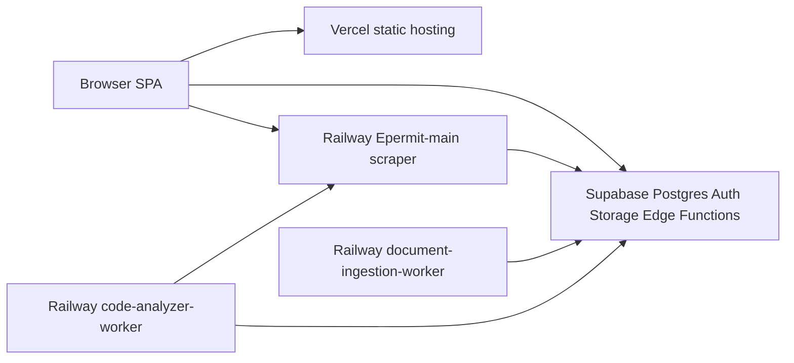
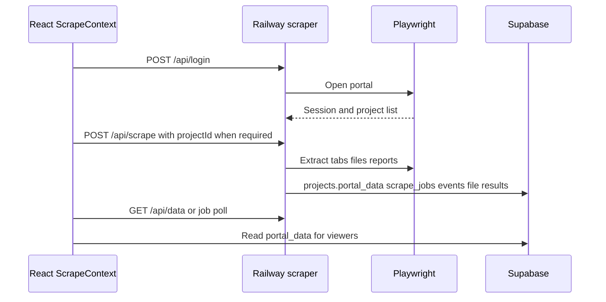

# 02 — System architecture

**Extraction date:** 2026-10-19  
**Code:** `main` @ `fc74c35`  
Labels: **VERIFIED**, **HISTORICAL**, **INFERRED**, **UNKNOWN**.

## Production shape

| Component | Code | Host | Evidence |
|-----------|------|------|----------|
| Frontend | `src/` Vite 5, React 18, TypeScript, Tailwind, shadcn/ui | Vercel. Documented URL `https://epermit-main-nine.vercel.app` | **HISTORICAL** client confirmation in `docs/diligence-readiness/ARCHITECTURE.md`. `vercel.json` **VERIFIED** (`npm run build`, `dist`, SPA rewrite). Live Vercel deploy SHA was **not** rechecked on 2026-10-19. |
| Scraper and most HTTP APIs | `scraper-service/server.js` | Railway service `Epermit-main` | **VERIFIED** online 2026-10-19 at `https://epermit-main-production.up.railway.app` |
| App data plane | `supabase/` | Supabase Cloud `eeqxyjrcldivtpikcpvk` | **VERIFIED** `config.toml` |
| Document RAG worker | `document-ingestion-worker/worker.js` | Railway `document-ingestion-worker` | **VERIFIED** production service online. Latest SUCCESS deploy **2026-08-04**, not `fc74c35`. |
| Code Analyzer worker | `code-analyzer-worker/worker.js` | Railway `code-analyzer-worker` | **VERIFIED** production service online. Latest SUCCESS deploy 2026-10-19, CLI message `fc74c35 evidence-backed analyzer pass`. |

There is no separate Node “application server” for ordinary CRUD. The React app talks to Supabase directly. Express exists for browser automation, UCI, QuickBooks, Microsoft Graph, filing, and drawing analysis (`memory.md` §1).

## Local development shape

**VERIFIED** `package.json` and `README.md`.

| Mode | Command | Frontend | Scraper |
|------|---------|----------|---------|
| Default | `npm run dev` | Vite `:5001` (`vite.config.parallel.ts`) | `parallel-dev-server.js` `:3002`, plus document-ingestion worker |
| Classic rollback | `npm run dev:classic` | Vite `:5000` (`vite.config.ts`) | `server.js` `:3001` |
| Analyzer worker | `npm run dev:code-analyzer-worker` | Not started by `npm run dev` | Separate process |

Vite proxies `/api` and `/view-file` to `127.0.0.1:3001` (classic) or `:3002` (parallel).

`parallel-dev-server.js` loads the same Express app as `server.js` and additionally mounts `/__future` (`scraper-service/app/routes/index.js`). That mount is a refactor sandbox. Production traffic does not depend on `/__future`. `GET /health` on the production host returned 404 in the 2026-08-27 Railway note because the health route lived under `/__future` only (`docs/diligence-readiness/RAILWAY_PRODUCTION_STATUS.md`, **HISTORICAL** HTTP check).

Frontend base URL resolution is `src/lib/scraperBaseUrl.ts`:

- Default production host: `https://epermit-main-production.up.railway.app`.
- `VITE_API_BASE_URL` overrides it, except a known-dead host `epermit-production.up.railway.app`.
- `VITE_SCRAPER_USE_SAME_ORIGIN=true` (set by the parallel Vite config) makes the browser use the Vite proxy.

`memory.md` §1 still describes the classic 5000→3001 pair as the primary story and mentions parallel ports. `README.md` is the current default: `npm run dev` is the parallel stack. Prefer the README for local ports.

## Frontend structure

**VERIFIED** by route and file inventory. Narrative detail in `docs/current-system-architecture.md` is dated **2026-07-21** and is stale where it disagrees with `src/` (see contradictions below).

Entry: `src/main.tsx` → `src/App.tsx`.

Provider order documented in the July architecture note: `QueryClientProvider` → `ThemeProvider` → `TooltipProvider` → `AuthProvider` → `LeadCaptureProvider` → `BrowserRouter`. Inside the dashboard shell: `SelectedProjectProvider`, `ScrapeProvider`, `SidebarProvider`. **HISTORICAL** layout description; re-read `App.tsx` before changing provider order.

| Area | Location | Role |
|------|----------|------|
| Routes and guards | `src/App.tsx`, `src/components/auth/ProtectedRoute.tsx`, `ModuleFlagGate` | Session, forced password change, module flags |
| Projects | `src/pages/Projects.tsx`, `src/components/projects/`, `src/hooks/useProjects.ts` | CRUD, team, documents, billing panel |
| Scrape session | `src/contexts/ScrapeContext.tsx` | Login/scrape/poll/cancel against Railway |
| Portal viewers | `src/components/portal/`, `src/pages/PortalDataViewer.tsx`, `src/lib/portalView.ts` | Render `portal_data` by portal type |
| Baltimore UI clone | `src/pages/baltimore/`, `src/components/baltimore/` | Separate mock chrome. Not the live Accela scraper. |
| Comments | `src/pages/CommentReview.tsx`, `ClassifiedComments.tsx`, `ResponseMatrix.tsx` | Review and matrix |
| DesignCheck | `src/pages/DesignCheck.tsx`, `src/lib/designcheck/` | Summary dashboard |
| Code Analyzer | `src/components/compliance/`, `src/lib/codeAnalyzer/`, `src/lib/codeModification/` | Upload, V2 jobs, findings |
| Permit wizard | `src/pages/PermitWizardFiling.tsx`, `src/components/permit-wizard/` | Filing UI |
| Inspections / checklists | `src/components/inspections/`, `src/components/checklists/` | Field workflows |
| UCI | `src/pages/Uci*.tsx`, `src/components/uci/`, `src/lib/uciApi.ts` | Operator workspace |
| Admin | `src/pages/admin/`, `src/components/admin/` | Platform governance |
| Operations | `src/pages/OperationsBoard.tsx`, `src/lib/operations/` | Mixed live and demo data |

Data access pattern: most screens use the Supabase JS client directly. TanStack Query is used narrowly (comment review, response matrix, and a few status cards per the July architecture note).

## Scraper process

**VERIFIED** entry chain: `server.js` → `createSharedHttpApp` (`app/http-app.js`) + `registerExecutionRoutes` (`app/register-execution-routes.js`). Deploy image: `scraper-service/Dockerfile` (Playwright `v1.58.2-jammy`, LibreOffice, `EXPOSE 3001`, `CMD node server.js`) and `scraper-service/railway.toml` (`builder = dockerfile`).

`register-execution-routes.js` is very large (on the order of ten thousand lines). It still owns portal branching. Later routers are mounted beside it.

Route groups (method-level list is not exhaustive):

| Group | Examples | Purpose |
|-------|----------|---------|
| Session | `POST /api/login`, `POST /api/scrape`, `GET /api/data/:sessionId`, `GET /api/progress/:sessionId`, logout/cancel, `GET /api/export/:sessionId` | Playwright session and extraction |
| Files | `GET /view-file/...` | Static files from `scraper-service/downloads/` |
| Accela plan review | `POST /api/accela/plan-review/continue-downloads`, `resume-downloads` | Long download resume |
| Compliance | `POST /api/analyze-drawing`, `/api/extract-drawing-index`, `/api/analyze-code-modification`, extract-form, review-sheet, merge | Called by the Code Analyzer worker |
| QuickBooks | `/api/quickbooks/*` | OAuth, status, invoice trigger |
| Microsoft Graph | `/api/microsoft/*` | Mailbox OAuth and status |
| UCI | `/api/uci/*` | Utility coordination API. August audit counted 139 handlers (**HISTORICAL** count, not re-counted). |
| Documents | `/api/documents/*` | Conversion helpers with project access checks |
| Credentials / admin | `/api/portal-credentials`, `/api/admin/v1/*` | Saved logins and governance HTTP API |
| Filing | `/api/permitwizard/*` and `/api/filing/*` | Momentum, Energov, Montgomery, and related filers |
| Webhook | `POST /webhooks/uci/email-inbound` | Optional shared secret `UCI_EMAIL_INBOUND_WEBHOOK_SECRET` |

In-process loops started with the scraper (not separate Railway services): Arlington durable scrape worker, UCI durable worker, Graph inbound poller, UCI lifecycle scheduler (`ARCHITECTURE.md` §3). **VERIFIED** as documented in that file’s code reading; loop start sites were not re-traced line by line in this extraction.

Portal detection (`memory.md` §3–4, **VERIFIED** as the handbook contract):

| Portal | Detection | Pipeline |
|--------|-----------|----------|
| Washington, DC | Default Avolve host `washington-dc-us.avolvecloud.com`; subtype `dc-planreview` | Generic ProjectDox path in `server.js` / execution routes |
| Prince George’s County | `pgc-eplan` host | `pgc-eplan-scraper.js`, subtype `pgc-eplan` |
| Montgomery County | Montgomery ProjectDox host, before generic ProjectDox | `scrapers/montgomery/`, subtype `montgomery-projectdox` |
| Howard County | Howard ProjectDox host | `scrapers/howard/` |
| Accela | URL contains `accela.com` | `accela-scraper.js`. Branches for Baltimore, Arlington, Fairfax |
| Unknown | Anything else | Login returns 400 |

Supabase access from the scraper uses `SUPABASE_URL` and `SUPABASE_SERVICE_ROLE_KEY` (`lib/supabase-admin.js` and execution routes). Do not copy those values into docs or the frontend.

Scrape file uploads call `ensureStorageBucket` in `register-execution-routes.js`, which creates storage bucket `project-drawings` as public or updates an existing bucket to public. That bucket is not created by a migration. Document metadata for the RAG path uses `project-documents`. See [04-DATABASE-AND-SUPABASE.md](./04-DATABASE-AND-SUPABASE.md).

## Workers

### Code Analyzer worker

`code-analyzer-worker/worker.js` polls every `CODE_ANALYZER_POLL_INTERVAL_MS` (default 3000). It claims three job families:

| Claim | Processor | Then |
|-------|-----------|------|
| Ingestion | `lib/processIngestionJob.js` | Sheets, segments, spec indexing |
| Sheet analysis | `lib/processSheetJob.js` | HTTP `POST` to scraper `/api/analyze-drawing` |
| Code modification | `lib/processCodeModJob.js` | HTTP `POST` to scraper `/api/analyze-code-modification/*` |

It requires `SUPABASE_URL`, `SUPABASE_SERVICE_ROLE_KEY`, and OpenAI for embeddings. `SCRAPER_SERVICE_URL` tells it where the compliance API lives. The worker default in code is `http://localhost:3000`, while the scraper listens on **3001** unless `PORT` is set. That mismatch is a local footgun (**VERIFIED** by the deployment-evidence pass against worker source; confirm the constant before changing it). Production must set `SCRAPER_SERVICE_URL` to the Railway scraper URL. The value was not read.

Railway build for this service is the **repo-root** `nixpacks.toml`: Node 20, canvas native libraries, `cd code-analyzer-worker && npm ci`, start `node code-analyzer-worker/worker.js` with `LD_LIBRARY_PATH` for `libuuid`. The comment in that file says the root is required because `processSheetJob.js` imports `scraper-service/app/services/compliance/findingQuality.js`. A second, slimmer `code-analyzer-worker/nixpacks.toml` starts `node worker.js` from the worker directory only. The root file matches the import constraint. Which file Railway actually used for the 2026-10-19 deploy was **not** re-read from the deployment manifest (**UNKNOWN**).

### Document ingestion worker

`document-ingestion-worker/worker.js` polls `document_ingestion_jobs` where status is pending, downloads `project_documents` from storage, extracts PDF or DOCX text, chunks, embeds, and writes `project_document_chunks`.

Low-text PDFs get the message in `LOW_TEXT_MSG`: OCR is not enabled. This pipeline is the comment/RAG path. It is not the Code Analyzer sheet pipeline.

`npm run dev` starts this worker locally and does **not** start the Code Analyzer worker.

## Edge Functions

51 function directories under `supabase/functions/` (excluding `_shared`). They cover Stripe, Resend email, the comment-agent pipeline, permit wizard, Shovels, Mapbox, shadow mode, and drawing analysis. Inventory and JWT settings: [04-DATABASE-AND-SUPABASE.md](./04-DATABASE-AND-SUPABASE.md).

`permitwizard-execute` calls the scraper. The Edge env name is `SCRAPER_SERVICE_URL` (`docs/diligence-readiness/ENV.md`). That name is easy to confuse with the worker’s same variable.

## Data flows

### Portal harvest

`portal_data` shape depends on `portalType` / `portalSubtype`. Viewers do not discover new keys automatically (`memory.md` §5). `hashPortalData` (stable stringify + SHA-256) is used so unchanged JSON is not rewritten blindly.

### Comment grounding

Uploaded or scraped PDFs become `project_documents` → `document_ingestion_jobs` → worker → `project_document_chunks` (pgvector). `generate-grounded-response` retrieves chunks when drafting. The legacy `generate-response` path still exists. Point 7 spec: `point-7-grounded-ai-implementation.md` (**HISTORICAL** build ticket; tables and the function now exist).

### Code Analyzer V2

UI (`CodeAnalyzerDocumentWorkflow`, `AIComplianceAnalyzer`) creates async runs only if `assertNewAnalysisUsesV2()` passes. Jobs land in analyzer tables. The worker claims them. Sheet analysis calls back into the scraper’s compliance service, which checks service auth (`scraper-service/app/services/compliance/compliance-service-auth.js`). Findings are filtered in `src/lib/complianceResultFilter.ts` and summarized for DesignCheck in `src/lib/designcheck/designCheckSummary.ts`.

Latest `main` commit message requires evidence on the sheet before a Code Analyzer pass. Treat “pass” as evidence-backed, not as a default optimistic result.

## Contradictions to remember

| Topic | Older statement | Current evidence |
|-------|-----------------|------------------|
| Code Analyzer async v2 | `ARCHITECTURE.md` §6 (2026-08-27): branch intentionally local-only, not on remote, not in production | **VERIFIED** code is on `main`. Remote branch `feat/code-analyzer-async-v2` exists. Production Railway service `code-analyzer-worker` was online on 2026-10-19 with a deploy message naming `fc74c35`. |
| `PublicOnlyRoute` | `memory.md` §2 and `docs/current-system-architecture.md` (2026-07-21) | **VERIFIED** no `PublicOnlyRoute` symbol under `src/` on 2026-10-19. Auth gating is `ProtectedLayoutRoute`, `HomeRoute`, and the password-change route. |
| Feature flags storage | July architecture note: `useFeatureFlags` is localStorage only | **VERIFIED** `src/lib/featureFlags.ts` calls RPC `get_feature_flags` and still names a legacy key `permitpulse_feature_flags`. Route gating also uses `src/lib/moduleFeatureFlags.ts`. |
| Dev ports | August architecture diagram describes 5000→3001 only | **VERIFIED** default script is 5001→3002 plus ingestion worker. |
| Ingestion worker currency | Diagrams imply it tracks `main` | **VERIFIED** production deploy SUCCESS is dated 2026-08-04. |

## External systems

Named in code and diligence docs. Whether production credentials are valid was **not** retested, except where a 2026-08 status check is cited.

| System | Use | Where |
|--------|-----|--------|
| OpenAI | Agents, embeddings, drawing analysis | Edge Functions and both workers |
| Stripe | Checkout, portal, webhooks | `create-checkout`, `customer-portal`, `stripe-webhook`, `check-subscription` |
| Resend | Transactional email | `send-*` functions |
| Intuit QuickBooks | Milestone and UCI invoices | Scraper `/api/quickbooks/*` |
| Microsoft Graph | UCI mailbox | Scraper `/api/microsoft/*` |
| Mapbox | Jurisdiction map | `get-mapbox-token` |
| Shovels | Permit lookup | `shovels-api`, `fetch-permit-data` |
| Firecrawl | Portal status check | `check-portal-status` |
| ElevenLabs | TTS | `elevenlabs-tts` |
| Accela / Avolve portals | Scraping and filing targets | Playwright |

Secret values live in Supabase secrets, Railway variables, and Vercel env. `docs/diligence-readiness/ENV.md` inventories **names** (138 unique names as of 2026-08-27). Do not paste values into this folder.
